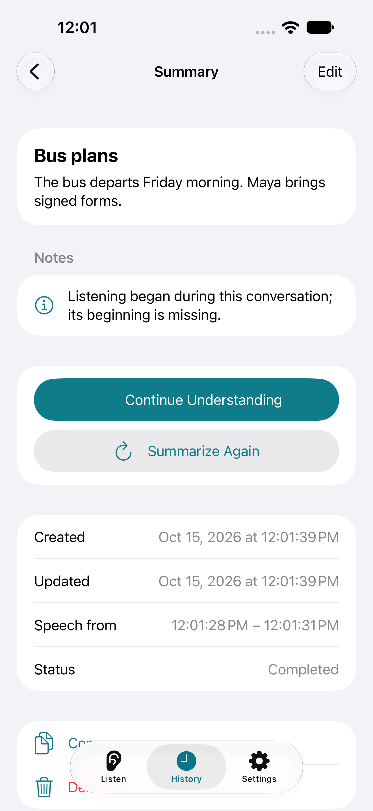
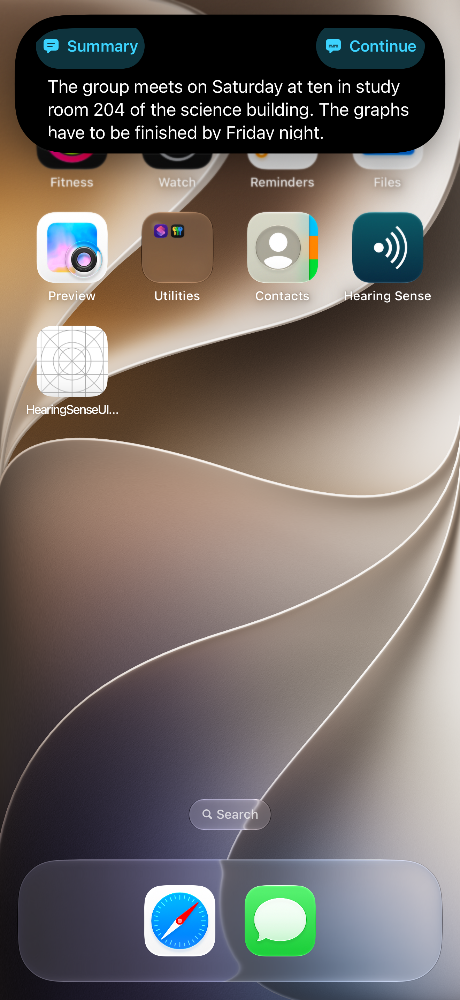

# Window 9 stability and direct summary navigation

2026-10-15, America/Denver. Isolated `feature/window9-summary-postprocessing` worktree,
based on `5a02c54`; no merge or push. Existing model, quantization and ordinary History remain
in place. Evidence under `results/window9/stability/` contains synthetic fixtures and metadata only.

## Delivered behavior

- Summary opens a dedicated page immediately. Its request ID binds to the newly saved record;
  History uses the same full-summary component. There are no placeholder History rows.
- Repeated taps coalesce. Cancelled, suspended and superseded requests cannot replace newer
  results. Failed updates retain the last accepted summary and explicitly report the failure.
  A failed fresh Summary followed by Continue updates the existing record instead of inserting a duplicate.
- Caption updates scroll only the caption view, and only while following its bottom. Summary
  pages remain selected during incoming speech and Continue updates.
- Native inference, prewarming and cleanup are serialized. A visible timeout requests cancellation;
  subsequent heavy inference waits for actual native cleanup. Restatement and verification use
  the engine identity of their draft, rather than a shared last-engine value.
- Summary, Continue and full rewrite share a monotonic request budget: production 66 seconds,
  at most 40 seconds for Qwen and 25 for Apple, clipped to remaining time with 10 seconds reserved
  for final checks. Simulator Debug has a separately labeled CPU budget.
- Foreground loss cancels/suspends work and prevents new inference submissions. Foreground
  return resumes an explicitly requested Summary or an eligible Continue update from bounded,
  still-valid context. No background GPU entitlement was added.
- Progress displays actual stages and elapsed time. Bounded traces record random IDs, revisions,
  stage/outcome codes, counts and durations; no conversation text or content fingerprints.
- Dynamic Island uses 44 pt Summary/Continue controls, 17 pt default body text, up to three lines,
  controls beside the camera instead of a separate bottom row, and matching preview-selection/rendering width. The preview selects more
  complete information without changing the stored full summary.
- Final factual, numeric, negation, retention, grounding, aggregate-copy and consecutive-copy
  gates remain in place. A refused/failed save never claims that the summary was saved.

## Validation

| Check | Result / evidence |
| --- | --- |
| Core regression | All 10 Swift Testing executables passed; 9 opt-in/unsupported tests skipped. |
| Window 9 checks after timing instrumentation | 46 tests in 4 suites passed. |
| Actual iPhone Qwen pipeline | **28/28**, including correction, numeric retention, Continue rewrite, isolated disk reopen and cancellation; `phone_qwen.txt`. |
| Actual iPhone Apple fallback | **28/28**, actual missing-Qwen reason and Apple identity; `phone_apple.txt`. |
| Controller lifecycle/save failure fixtures | **19/19**; duplicate taps, ongoing captions, failed Summary, Continue after failure, background cancellation/resume, late result, write failure and Stop; `controller_checks.json`. |
| Simulator real Qwen CPU | **3/3**, native load/inference/parsed recap; 130.27 seconds under a separate Debug allowance; `simulator_cpu_probe.txt`. This is not an iPhone speed measurement. |
| Fixed audio | iPhone SpeechAnalyzer completed; 18 recognized words, Friday/tickets/forms present, summary accepted and saved, microphone false; `phone_fixed_audio.json`. |
| Simulator speech recognition | System transcriber unsupported in this runtime. The real-audio acceptance was transferred to iPhone; not counted as a Simulator ASR pass. |
| Simulator UI | **4/4** at default size and **4/4** at extra-large, plus a final default-size Island layout check. Pending-to-full Summary, same History text, background/resume and actual Island intent opening Summary passed. Synthetic save-to-visible latency **0.419 / 0.386 s**. Final large-size run needed no setup restart. |
| Island visual inspection | Default: three complete readable preview lines; extra-large: fewer complete sentences selected to fit. Both control frames at least 44 pt. Text and labels visible without truncation in the inspected samples; screenshots below. |
| Device deployment | Final development-signed **Release** built and installed in place. After the user unlocked/opened the phone, final launch succeeded and a second process check confirmed the app remained running from the exact newly installed bundle. Read-only History → Summary navigation visually passed during Release operation checks. No microphone start was requested. Debug fixture flags/engine marker absent from Release. |

The audio fixture is a fixed English AIFF generated locally with the system Samantha voice:
Friday meeting at 7:45, twenty dollars for tickets, and signed forms. No ambient audio was captured.
The first audio harness kept only the last recognition segment; it was corrected to use the
production `TranscriptAssembler` and wait for final event delivery. The first combined walkthrough
also incorrectly assumed a lifetime recap counter was zero after the preceding audio test;
it now compares the counter before/after speech injection. Those earlier harness failures are
not counted as successful runs.

## Timing and before/after comparison

Native Mac and iPhone use **Metal**. The Simulator uses the project CPU adapter.
Both four-run benchmarks use the same fixed English input, 516 prompt tokens and 83 output tokens.
“Cold” means a fresh engine/model object, with normal OS/shader caches; it does not mean a reboot.

| Environment | Cold total | Three warm totals | Warm generation rate |
| --- | ---: | --- | --- |
| iPhone 18 Pro / Metal | 4.349 s | 2.791 / 2.770 / 2.699 s | 39.58 / 39.97 / 41.24 tokens/s |
| Mac native / Metal | 7.762 s | 3.002 / 3.017 / 3.019 s | 42.42 / 42.24 / 42.15 tokens/s |

The cold iPhone load span was 1.456 seconds, first output 0.749 seconds after generation began,
and generation 2.884 seconds. The cold Mac load span was 4.444 seconds. The recorded Mac trial
ran after other builds and UI work finished; an earlier overlapping trial is excluded from these values.

| Same application fixture | Prior validated release candidate | This candidate |
| --- | ---: | ---: |
| Qwen initial tap-to-ready | 8.6 s | 8.2 s |
| Qwen speech-to-Continue result, including 20 s cadence | 33.9 s | 32.9 s |
| Apple initial tap-to-ready | 3.9 s | 3.3 s |
| Apple speech-to-Continue result, including cadence | 24.7 s | 27.6 s |
| Qwen initial full summary / Island preview | 593 / 76 characters | 593 / 127 characters |

The old short iPhone native probe took 8.990 seconds for the same 516/83 tokens; its generation
rate was 41.17 tokens/s. The new results do **not** establish a faster GPU kernel: cache/startup
state and test instrumentation differ, and warm rates are similar. There is no matched historical
Mac four-run baseline, so no Mac before/after speedup is claimed. The Apple Continue result also
shows that this work does not make every model run faster.

New request traces explain where time goes. The full Qwen Summary request took 8.177 seconds:
8.076 generation, 0.049 initial deterministic checking, about 0.0055 saving, then 0.0054 to publish
the saved result on the main actor. Continue used 12.745 seconds inside the request: 4.025 for the
incremental draft and 8.519 for the full rewrite, plus checks/save. Its roughly 33 seconds from
speech injection includes the existing 20-second update cadence. Stage spans can nest and must
not be summed as independent durations. Trace timestamps are monotonic; terminal elapsed time
is frozen, while later native cleanup may still append events.

Save-to-main-actor-publication gaps in the physical trace were 1.9–5.4 ms. The UI test separately
observed the full summary as hittable 0.419 seconds after saving, below the one-second target.
The final extra-large run measured 0.386 seconds.
These are small synthetic measurements, not a general thermal, load or latency guarantee.

## Reproduction and limits

Use the existing custom Metal toolchain and the pinned preparation script. The runtime patch
adds a cancellation check before a ChatSession producer acquires its native cache; weights and
upstream versions are unchanged. `Package.resolved` now reflects the already-local MLX packages.

- Core: `swift test --package-path packages/HearingSenseKit --enable-swift-testing --parallel`.
- UI: Xcode `HearingSense` scheme, Debug, Simulator, `HearingSenseUITests`, serial testing.
- iPhone synthetic sequence: Debug `--hs-w9-device-acceptance --hs-w9-persist --hs-w9-expect qwen
  --hs-synthetic-capture --hs-test-mode locked --hs-test-allow model --hs-test-session-limit 600`.
  It reads only `Documents/window9-fixed-input.aiff`, then runs the native pipeline and scripted
  lifecycle checks. Persisted test records use `Window9SyntheticHistory`, never ordinary History.
- Forced Apple: `--hs-w9-selftest --hs-w9-persist --hs-w9-expect fallback --hs-engine qwen-missing`
  with the same synthetic/locked/model-only options.
- Native Mac: `hs-qwen-probe --stability-benchmark`; iPhone: `--hs-w9-benchmark` with model-only
  test options. Reports contain metadata only. All test launch modes are excluded from Release.

No thermal/endurance campaign, low-memory pressure injection, background/locked Metal inference,
or fresh microphone-based Release inference was performed. Native functional inference evidence
comes from Debug; Release operation checks are identified separately. Existing ordinary records
were visually available after an in-place install; no uninstall, reset or private History export.

Simulator setup limitations: a cold Debug fixture sometimes failed to appear on its first launch;
the UI harness records and permits one setup restart, with no retry of functional assertions.
An attempted Home-based fixture was stopped by its transcription-off test policy; the final
Simulator UI path therefore uses fixed captions, as its unsupported system transcriber requires.
Those failed setup runs are not counted as passing functional tests. The Debug launch aid now
owns its task lifetime so view replacement cannot cancel the acceptance sequence.

